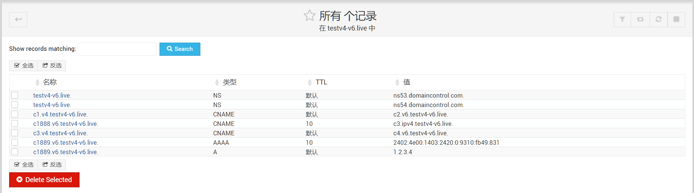
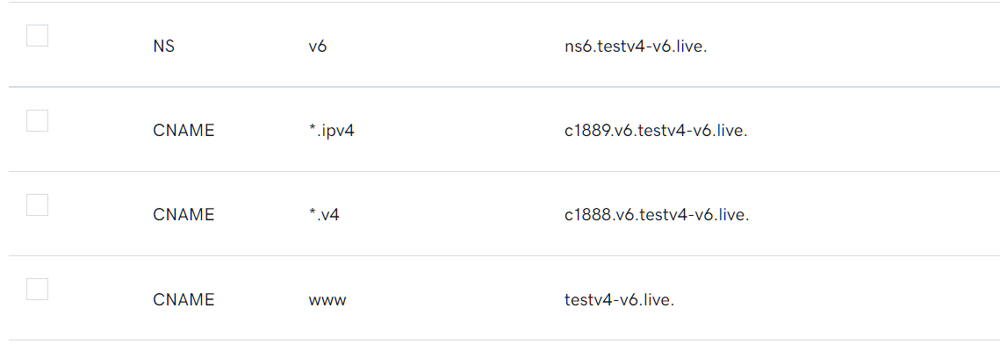

# DNSv6

### 组织结构

```
├─Code				#dns探针发送代码
├─result			#自建NS端的pcap结果以及5次探针发送情况
│  └─china
│      ├─forward	#转发
│      ├─gkdg		#公开递归
│      ├─jjdg		#间接递归
│      └─zjxy		#直接响应
└─src
	├─china 		#ipv4的种子地址数据，来自@莫迪凯
	└─shandong		#山东v4数据
		├─IPrange 	#三大运营商IPv4网段数据
		└─dns		#已知v4 dns
```

### 原理


### 配置

#### 自建NS端



#### godaddy端



